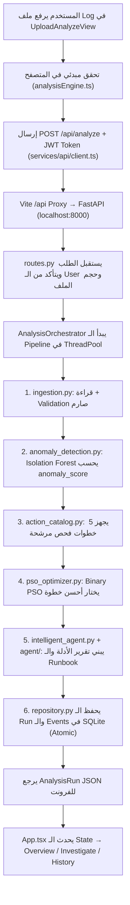

# دليل فهم مشروع TraceMind من جوه (بالبلدي — خطوة بخطوة)

> **المكتوب هنا لمين؟** لمحمد وفريق TraceMind — شرح بسيط بالعربي المصري من غير تعقيد ولا كود كتير، عشان تبقى فاهم كل حتة في المشروع ماشية إزاي قبل الديمو والمناقشة.

---

## 1. الفكرة العامة في 5 سطور بالبلدي

تخيّل إن عندك سيرفر أو أبلكيشن بيطلّع آلاف سطور الـ **Logs** كل يوم (زمن استجابة، أخطاء HTTP، استهلاك CPU و Memory...).
المهندس لو قعد يقرأ السطور دي بعينه عشان يلاقي المشكلة فين، هيتعب وممكن يفوّت حاجات مهمة.
**TraceMind** هو لوحة تحكم ذكية (**Dashboard**) بترفع عليها ملف الـ Logs (سواء CSV أو JSON أو JSONL أو ملف `.log` عادي)، والنظام لوحده بيفرزهم بـ **Isolation Forest** عشان يطلّع السطور الغريبة (**Anomalies**).
بعد كده، خوارزمية **Binary PSO** بتختارلك أحسن خطوة فحص (**Read-Only Investigation Action**) تعملها الأول بأقل تكلفة ومخاطرة، و**Intelligent Agent** يكتبلك تقرير واضح بالأدلة يقولك ليه الخطوة دي اتختارت وإيه خطوات الفحص المقترحة.
كل ده بيتخزّن في قاعدة بيانات **SQLite** بحساب خاص لكل مستخدم، ومن غير ما يلمس أو يعدّل أي سيرفر حقيقي (كله **Read-Only Advisory**).

---

## 2. خريطة رحلة الداتا (Flow Diagram)



---

## 3. رحلة الداتا خطوة بخطوة بمثال حقيقي (5 سطور Log)

تخيّل إنك رفعت ملف CSV اسمه `checkout-sample.csv` فيه 5 سطور بس:

```text
1) evt-1 | auth-service | latency=45ms  | error_rate=0.01 | cpu=22% | status=200  (عادي)
2) evt-2 | auth-service | latency=50ms  | error_rate=0.02 | cpu=25% | status=200  (عادي)
3) evt-3 | api-gateway  | latency=8900ms| error_rate=0.95 | cpu=97% | status=503  (بايظ خالص!)
4) evt-4 | auth-service | latency=48ms  | error_rate=0.01 | cpu=24% | status=200  (عادي)
5) evt-5 | auth-service | latency=51ms  | error_rate=0.02 | cpu=23% | status=200  (عادي)
```

امشي ورا الـ 5 سطور دول لحظة بلحظة:

1. **الرفع في المتصفح (`src/components/UploadAnalyzeView.tsx` + `src/utils/analysisEngine.ts`)**:
   بتسحب الملف وتحطه في صفحة **Analyze** وتضغط **Run TraceMind Analysis Pipeline**. قبل ما يبعت حاجة للباك، الفرونت بيتأكد إن الملف مش فاضي، وحجمه أقل من 25 MB، وصيغته سليمة.
2. **الإرسال للباك (`src/services/api/analysis.ts` → `src/services/api/client.ts`)**:
   الـ `apiRequest` بياخد الـ **JWT Access Token** اللي في الذاكرة، يحطه في هيدر `Authorization: Bearer ...`، ويبعت طلب `POST /api/analyze`. الـ **Vite Proxy** (`vite.config.ts`) بيلقط `/api` ويحوّله تلقائياً لـ FastAPI على `http://127.0.0.1:8000`.
3. **الاستقبال والتأكد من الهوية (`backend/app/api/routes.py`)**:
   الـ `routes.py` بيتأكد الأول إنك مسجّل دخول (`get_current_user`)، وإن حجم الملف أقل من 25 MB (وإلا يرجّع `413`)، وبعدين يبعت الداتا لـ `AnalysisOrchestrator` داخل `run_in_threadpool` عشان السيرفر مايهنجش وهو بيحسب الـ ML.
4. **القراءة والتحقق الصارم (`backend/app/services/ingestion.py`)**:
   بيقرأ الـ 5 سطور، ويتأكد إن الـ 9 أعمدة الأساسية موجودة وإن الأرقام منطقية (مثلاً `error_rate` بين 0 و 1، و`cpu_pct` بين 0 و 100). لو فيه سطر واحد بايظ، بيوقف العملية ويرجع `422` فيه رقم السطر الغلط — مفيش أي تطنيش صامت.
5. **اكتشاف الشذوذ (`backend/app/services/anomaly_detection.py`)**:
   **Isolation Forest** بياخد الـ 5 سطور، يعملهم توحيد مقياس (**StandardScaler**)، ويشوف مين السطر اللي بيتفصل بسرعة عن الباقي. يطلعله إن `evt-3` شاذ (`is_anomaly: true`، والـ `anomaly_score` بتاعه قريب من `1.0` يعني **critical**)، والـ 4 سطور التانيين طبيعيين (`normal`). كمان يحسب لكل سطر مين أكتر ميزة خلّته غريب (`primary_driver` مثل `latency_ms` أو `error_rate`).
6. **تجهيز الحلول المرشحة (`backend/app/services/action_catalog.py`)**:
   بيجيب الـ 5 خطوات فحص الجاهزين في الكتالوج (`ACT-SERVICE`، `ACT-TIMELINE`، `ACT-RESOURCE`، `ACT-ERROR`، `ACT-LATENCY`) ويحسب لكل واحدة فائدتها المتوقعة بناءً على أرقام الـ `evt-3` (لإن فيه `status=503` و`error_rate=0.95`، فـ `ACT-ERROR` بياخد أعلى فايدة).
7. **اختيار أحسن خطوة (`backend/app/services/pso_optimizer.py`)**:
   الـ **Binary PSO** بيجرّب تشكيلات من الـ 5 خطوات على مدار 25 دورة (**iterations**) عشان يوازن بين الفايدة والتكلفة والمخاطرة والسرعة، ويختار في الآخر أحسن خطوة واحدة: مثلاً **`ACT-ERROR` — Examine repeated error patterns**.
8. **كتابة التوصية بالأدلة (`backend/app/services/intelligent_agent.py` + `backend/app/services/agent/`)**:
   الـ **Intelligent Agent** بياخد كل اللي حصل فوق كأدلة (**Evidence**)، يبني منها استنتاجات (**Beliefs**) وأهداف (**Goals**)، ويطلعلك تقرير جاهز فيه: العنوان، شرح الأدلة (مع التأكيد إنها **investigation leads** مش أسباب جذرية مؤكدة)، خطوات فحص يدوية، والـ **Guardrails** اللي اتأكد منها.
9. **الحفظ في قاعدة البيانات (`backend/app/db/repository.py`)**:
   الـ `AnalysisOrchestrator` بيفتح **Transaction واحدة** (`with session.begin():`) ويحفظ ملخص الـ Run في جدول `analysis_runs` والـ 5 سطور بتفاصيلهم في جدول `event_records`. يا إما كلهم يتحفظوا صح، يا إما مفيش حاجة تتحفظ.
10. **الرجوع للفرونت والعرض على الشاشة (`src/App.tsx` → الـ Views)**:
    الباك يرجّع JSON كامل اسمه `AnalysisRun`. الفرونت يتأكد إنه سليم (`validateAnalysisRunResponse`)، يحطه في الـ state جوه `App.tsx`، وينقلك أوتوماتيك على **Overview** تشوف فيه الكروت والرسم البياني، ومنها تدخل **Investigate** تشوف جدول الـ 5 أحداث وتوصية الـ PSO والـ Agent، وكله متخزّن في **History**.

---

## 4. شرح كل فولدر وملف مهم بالبلدي (بيعمل إيه وبيكلم مين؟)

### أولاً: الباك إند (`backend/app/`)

| الملف / الفولدر | مسؤول عن إيه بالبلدي؟ | بيكلم مين؟ |
|---|---|---|
| `backend/app/main.py` | **بوابة ومدير السيرفر**. بيشغّل FastAPI، يتأكد إن جداول الـ DB موجودة ومتصلة وقت الإقلاع، ويظبط الـ CORS (بما فيه هيدر `Authorization`)، وضغط GZip، والـ Rate Limiter، والـ Error Handlers، ويربط `/api` و`/health`. | بيستورد `routes.py`، `config.py`، `database.py`. |
| `backend/app/api/routes.py` | **موظف الاستقبال (الـ Endpoints)**. يستقبل طلبات HTTP (Register, Login, Refresh, Analyze, History, Delete)، يتأكد من الـ Token ومن حجم الملف، ويسلّم الشغل للـ Services من غير ما يعمل حسابات ML بنفسه. | بيكلم `auth.py`، `AnalysisOrchestrator`، و`AnalysisRepository`. |
| `backend/app/services/analysis_orchestrator.py` | **المايسترو**. بينسّق الـ 5 مراحل بالترتيب (Ingestion → IF → Catalog → PSO → Agent) وبعدين يحفظ النتيجة مرة واحدة في SQLite. | بيكلم كل ملفات `services/` و`repository.py`. |
| `backend/app/services/ingestion.py` | **بوابة فحص وتنظيف البيانات**. بيقرأ CSV / JSON / JSONL / LOG، يتأكد من الأعمدة والأنواع، ولو الملف Text Log عادي بيستخرج منه ميزات ذكية (زي طول الرسالة، كلمات ERROR/WARN، ندرة الكلمات) من غير ما يخترع أرقام CPU وهمية. | بيتنده من `AnalysisOrchestrator`. |
| `backend/app/services/anomaly_detection.py` | **عقل اكتشاف الشذوذ**. بيشغّل `StandardScaler` + `IsolationForest`، يطلّع لكل سطر `anomaly_score` من 0 لـ 1 وشدة (`critical`/`high`/`medium`/`normal`) وأهم ميزة أثّرت عليه. | بيتنده من `AnalysisOrchestrator`. |
| `backend/app/services/action_catalog.py` | **منيو خطوات الفحص**. فيه 5 خطوات فحص Read-Only للـ Telemetry و5 للـ Generic Logs، وبيحسب لكل خطوة فايدتها المتوقعة بناءً على البيانات اللي طلعت. | بيتنده من `AnalysisOrchestrator`. |
| `backend/app/services/pso_optimizer.py` | **مُفاضل الخطوات (Binary PSO)**. بياخد الـ 5 خطوات من الكتالوج ويشغّل سرب جزيئات (Swarm) عشان يختار أحسن خطوة بأعلى Fitness وأقل تكلفة/مخاطرة/وقت، ويسجّل تاريخ التحسّن (`convergence_history`). | بيتنده من `AnalysisOrchestrator`. |
| `backend/app/services/agent/` (ومعه `intelligent_agent.py`) | **محلل التقرير الذكي (Deterministic)**. متقسّم لـ 5 ملفات صغيرة: `evidence.py` (يجمّع الأدلة)، `beliefs.py` (يكوّن استنتاجات)، `planning.py` (يحوّلها لأهداف وخطط)، `explanation.py` (يكتب النص والـ Runbook والـ Guardrails)، و`models.py` (شكل البيانات). | بيتنده من `AnalysisOrchestrator` ومش بيتدخل في قرار الـ PSO ولا بينفذ أوامر. |
| `backend/app/db/database.py` | **كابل قاعدة البيانات**. بيعمل اتصال SQLAlchemy بـ SQLite، ويفعّل `PRAGMA foreign_keys=ON` و`WAL` mode عشان القراءة والكتابة المتوازية ماتعلقش. | بيستخدمه `main.py` و`routes.py` و`models.py`. |
| `backend/app/db/models.py` | **خريطة الجداول**. بيعرّف الـ 4 جداول بتوع قاعدة البيانات وأعمدتهم والعلاقات بينهم (`users`, `refresh_tokens`, `analysis_runs`, `event_records`). | بيستخدمه `repository.py` و`routes.py` وAlembic. |

### ثانياً: الفرونت إند (`src/`)

| الملف / الفولدر | مسؤول عن إيه بالبلدي؟ | بيكلم مين؟ |
|---|---|---|
| `src/App.tsx` | **المخ الرئيسي للواجهة**. ماسك الـ State كله: مين المستخدم اللي مسجّل دخول، إيه الـ Tab المفتوحة (Overview / Analyze / Investigate / History)، قائمة الـ Runs، وإيه الـ Run والـ Event المختارين حالياً. | بيكلم `services/api/` وبيوزّع الداتا كـ Props على كل الـ Components. |
| `src/services/api/` | **وسيط الاتصال بالباك**. `client.ts` فيه الـ `fetch` الموحد + التوكن + تجديد التوكن أوتوماتيك على 401؛ `analysis.ts` يبعت التحليل؛ `history.ts` يجيب ويمسح التاريخ؛ `index.ts` يجمعهم مع الـ Auth والـ Health Check. | بيكلم الباك (`/api/...`) وبيستقبل منه الطلبات من `App.tsx`. |
| `src/components/OverviewView.tsx` | **شاشة النظرة السريعة**. لو مفيش Runs بتعرض صفحة الهبوط (`LandingPageSection` بـ Lazy Loading)، ولو فيه Run بتعرض ملخص الأرقام (عدد الأحداث، الشذوذ، التوصية المختارة، وأهم 3 أحداث شاذة). | بياخد `run` من `App.tsx` ويبعتك لـ `Analyze` أو `Investigate`. |
| `src/components/InvestigateView.tsx` | **غرفة التحقيق**. مجرد حاوية فيها 3 تبويبات داخلية: **Events** (الجدول)، **Recommendation** (PSO + Agent)، و**Model evidence** (الرسومات). | بينظم التنقل بين `AnomaliesTableView` و`PsoAgentView` و`DashboardView`. |
| `src/components/AnomaliesTableView.tsx` | **جدول فحص الأحداث**. يعرض كل سطور الـ Log مع بحث وفلترة (شاذ فقط / شدة / خدمة) وترتيب وتصدير CSV، ولما تضغط على أي سطر يفتحلك لوحة جانبية (**Inspector**) توريك ليه السطر ده شاذ. | بياخد `run.events` من `InvestigateView`. |
| `src/components/PsoAgentView.tsx` | **شاشة الـ PSO والـ Agent**. بتعرض الـ 5 خطوات المرشحة ومقارنتها، الخطوة المختارة، تحليل الـ Agent، خطوات الـ Runbook، الـ Guardrails، وزرار Simulate (مقفول عمداً عشان المشروع Read-Only). | بياخد `pso_optimization` و`agent_recommendation` من `InvestigateView`. |
| `src/components/DashboardView.tsx` | **شاشة الأدلة والرسومات البيانية (Model Evidence)**. بترسم بنفسها بـ SVG (من غير مكتبات خارجية): توزيع درجات الشذوذ، تأثير الميزات (`feature_importances`)، ومنحنى تقارب الـ PSO. بتتحمل بـ `React.lazy()` عشان تسرّع فتح الموقع. | بتاخد `run` من `InvestigateView` لما تفتح تبويب Model evidence. |

---

## 5. شرح الذكاء الاصطناعي والـ ML بالبلدي وبأمثلة من الحياة

### أ) Isolation Forest بيعمل إيه بالظبط؟
تخيّل إنك في **فصل فيه 100 طالب**، 98 طالب لابسين يونيفورم أزرق وقاعدين في صفوفهم، وطالبين بس لابسين بدلة حمراء وواقفين فوق المكتب.
لو قلت لحد: *"اسأل أسئلة عشوائية بسيطة (مثلاً: لونه أزرق؟ طوله فوق 170؟) لحد ما تعزل كل طالب لوحده"* — مين اللي هيتعزل بعد **سؤال واحد أو اتنين**؟ الطالبين اللي لابسين أحمر! أما الطلبة العاديين هتحتاج أسئلة كتير عشان تفصلهم عن بعض.
- **Isolation Forest** بيعمل كده بالظبط بـ 100 شجرة قرار عشوائية (`n_estimators=100`).
- السطر اللي بيتعزل في عمق قليل (`isolation_depth` صغير) بياخد درجة شذوذ عالية (`anomaly_score` قريب من `1.0`) ويتصنّف `is_anomaly = true`.
- الدرجة دي بتتطبّع بين `0` و`1` **جوه نفس الملف بس** — يعني `0.85` في ملف معناها إن السطر ده غريب مقارنة بباقي سطور **نفس الملف**.

### ب) Binary PSO بيختار الأكشن إزاي؟ وليه بنقول عليه Demonstrative؟
تخيّل إن عندك **سرب من 30 عصفورة** (`swarm_size=30`) بيدوروا في جنينة فيها 5 شجرات (دول الـ 5 Investigation Actions) عن الشجرة اللي فيها أحلى فاكهة وأقرب مسافة وأقل خطر.
كل عصفورة بتجرب اختيار (`0` يعني ما تختارش الخطوة دي، `1` يعني اختارها — وعشان كده اسمه **Binary**)، وتقيس نتيجته بمعادلة الـ **Fitness**:
`0.60 × الفايدة − 0.18 × التكلفة − 0.15 × المخاطرة − 0.07 × الوقت`
كل عصفورة بتفتكر أحسن مكان زارته هي (**Personal Best**)، وبتشوف أحسن مكان أي عصفورة في السرب وصلتله (**Global Best**)، وتميل ناحيته في الدورة الجاية على مدار 25 دورة (**iterations**).

**ليه بنقول عليه Demonstrative (توضيحي)؟**
بصراحة علمية قدام الدكتور في المناقشة: إحنا عندنا **5 خطوات بس**! يعني لو جربنا الـ 5 خطوات واحدة واحدة بـ `for` loop (وده اللي اسمه `exhaustive_best_action` في الكود)، هنعرف الأحسن في لحظة. فـ Binary PSO هنا معمول كـ **تطبيق عملي توضيحي** يورّي إزاي خوارزميات التحسين بالسرب بتشتغل وتتجمع (Convergence)، والـ Exhaustive Search موجود في الـ Tests كمرجع يتأكد إن الـ PSO جاب نفس النتيجة الصح.

### ج) الـ Intelligent Agent بيعمل إيه وبيكتب التوصية إزاي؟
مهم جداً تبقى عارف إن الـ Agent هنا **مش ChatGPT ولا LLM بيألف كلام!**
ده **Deterministic State Machine** (آلة حالة حتمية): يعني لو دخلتله نفس الداتا 100 مرة، هيطلعلك نفس التقرير بالحرف 100 مرة، ومستحيل يهلوس.
بيمشي في 4 خطوات جوه فولدر `agent/`:
1. **Evidence**: يجمع الحقائق المسجّلة بس (عدد الشواذ، أكتر ميزة شاذة، الخطوة اللي الـ PSO اختارها).
2. **Beliefs**: يكوّن ملاحظات مرتبطة بالأدلة (مثلاً: هل الأدلة كاملة ولا فيه حاجة ناقصة؟).
3. **Goals & Plans**: يربط الأدلة بالخطة اللي الـ PSO اختارها (من غير ما يلغي قرار الـ PSO).
4. **Explanation**: يكتبلك العنوان، والأسباب المحتملة مع تنبيه صريح إن دي **Investigation Leads** (خيوط بحث) مش أسباب جذرية مؤكدة، ويديك خطوات فحص يدوية + قائمة الـ **Guardrails** (إن النظام Read-Only ومش هينفذ أوامر على أي سيرفر).

### د) إيه الفرق بين `anomaly` و `confidence` و `evidence_coverage`؟
| المصطلح | معناه الحقيقي بالبلدي | مثال من الحياة |
|---|---|---|
| **Anomaly** | حاجة **غريبة إحصائياً** مختلفة عن المعتاد في نفس الملف — مش بالضرورة هجوم أو عطل مؤكد! | طالب جاب 100% والباقي جايبين 60% — هو Anomaly إحصائياً بس مش معناه إنه غش. |
| **Confidence** (بالمعنى العلمي) | نسبة **ثقة احتمالية** إن الحكم ده صح 100% (محتاج بيانات متصنفة ومُعايرة). | الطبيب يقولك "نتيجة التحليل بتقول بنسبة ثقة 95% عندك كذا". **TraceMind مش بيدّعي ده!** |
| **Evidence Coverage (`evidence_coverage_pct`)** | نسبة **اكتمال الأدلة** اللي وصلت للـ Agent من المراحل اللي قبله (الأحداث + IF + المرشحين + قرار PSO). يعني `100%` معناها إن كل الأوراق المطلوبة موجودة قدام الـ Agent عشان يكتب تقريره، مش إنه متأكد 100% من السبب! | القاضي بيقول "الملف كامل فيه الـ 4 تقارير المطلوبة" (100% coverage)، مش معناه إن المتهم مذنب بنسبة 100%. *(ملحوظة: حقل `confidence_score_pct` موجود بنفس الرقم بس عشان التوافق مع النسخ القديمة).* |

---

## 6. جدول الـ API Endpoints ببساطة

| Endpoint | بيعمل إيه؟ | بياخد إيه؟ | بيرجع إيه؟ (مثال) |
|---|---|---|---|
| `GET /api/health` (أو `GET /health`) | يتأكد إن السيرفر والـ SQLite شغالين | ولا حاجة | `200`: `{"status":"ok","database":"sqlite_connected","models":["IsolationForest","PSO","IntelligentAgent"]}` |
| `POST /api/auth/register` | ينشئ حساب جديد | `{"email":"demo@tracemind.app","password":"..."}` (12+ حرف) | `201`: بيانات الـ User + `access_token` + Refresh Cookie (HttpOnly) |
| `POST /api/auth/login` | تسجيل دخول | نفس الإيميل والباسورد | `200`: `access_token` جديد + Refresh Cookie |
| `POST /api/auth/refresh` | يجدّد الـ Access Token لما ينتهي بعد 10 دقايق | الـ Refresh Cookie أوتوماتيك | `200`: `access_token` جديد (بيلغي القديم للحماية) |
| `POST /api/auth/logout` | تسجيل خروج وإلغاء الجلسة | Header `Authorization: Bearer <token>` | `204`: فاضي ويمسح الـ Cookie |
| `GET /api/auth/me` | يرجّع بيانات المستخدم الحالي | Header `Authorization: Bearer <token>` | `200`: `{"id":1,"email":"demo@tracemind.app","role":"user"}` |
| `POST /api/analyze` | يشغّل الـ Pipeline الكامل ويحفظ النتيجة | Multipart ملف (`file`) أو JSON `{dataset_name, format, content, config}` + Bearer Token | `200`: `AnalysisRun` كامل (`run_id`, `isolation_forest`, `pso_optimization`, `agent_recommendation`, `events`) |
| `GET /api/history?limit=20&offset=0` | يجيب تاريخ التحليلات بتاعتك بـ Pagination | `limit` (افتراضي 20، أقصى 100) و`offset` + Bearer Token | `200`: `{"runs":[...], "limit":20, "offset":0}` |
| `GET /api/history/{run_id}` | يجيب تفاصيل Run واحد | `run_id` في الـ URL + Bearer Token | `200`: كائن `AnalysisRun` الكامل (أو `404` لو مش بتاعك/مش موجود) |
| `GET /api/history/{run_id}/events` | يجيب سطور الأحداث بس بتاعة Run معين | `run_id` + Bearer Token | `200`: `{"events":[...]}` |
| `DELETE /api/history/{run_id}` | يمسح الـ Run وكل أحداثه نهائياً | `run_id` + Bearer Token | `204`: اتمسح بالكامل (Cascade) |

---

## 7. قاعدة البيانات (`SQLite`)

عندنا **4 جداول** بس في `data/tracemind.db` (متعرّفين في `backend/app/db/models.py`):

1. **`users`**: حسابات المستخدمين (`id`, `email`, `password_hash` مشفّر بـ Argon2, `role`, `is_active`, `created_at`).
2. **`refresh_tokens`**: توكنات تجديد الجلسة (`id`, `user_id`, `token_hash` مشفّر بـ SHA-256, `family_id` لكشف سرقة التوكن، `expires_at`, `revoked_at`).
3. **`analysis_runs`**: كل عملية تحليل اتعملت (`run_id`, `owner_id`, `dataset_name`, `file_format`, `total_events`, `anomaly_count`, `result_json` فيه التقرير الكامل، `created_at`).
4. **`event_records`**: سطور الـ Log التفصيلية بتاعة كل Run (`id`, `run_id`, `event_id`, `is_anomaly`, `anomaly_score`, `event_json`).

**العلاقة بينهم في سطرين:**
- كل **User** واحد يملك أكتر من **Refresh Token** وأكتر من **Analysis Run** (1-to-Many) — وعشان كده كل مستخدم بيشوف تحليلاته هو بس.
- كل **Analysis Run** واحد جواه أكتر من **Event Record** (1-to-Many) بـ `ON DELETE CASCADE` — يعني لما تمسح Run من الـ History، كل سطوره في `event_records` بتتمسح معاه أوتوماتيك.

---

## 8. أشهر 5 أخطاء ممكن تحصل وقت التشغيل أو الديمو (والحل في سطر)

| # | الخطأ اللي هيظهرلك | السبب | الحل في سطر |
|---|---|---|---|
| 1 | **`Invalid email or password`** لما تجرب تدخل بـ `demo@tracemind.app` على جهاز جديد | قاعدة البيانات المحلية جديدة والحساب لسه متسجلش فيها. | اضغط **New here? Create an account** وسجّل الحساب مرة واحدة، أو شغّله من قبل الديمو. |
| 2 | **`422` عند التسجيل بإيميل زي `test@audit.local`** | `EmailStr` بيرفض النطاقات المحجوزة زي `.local`. | استخدم إيميل شكله حقيقي زي `demo@tracemind.app` وباسورد 12 حرف على الأقل. |
| 3 | **`429 Too many attempts`** في نص الديمو | الـ Rate Limit الافتراضي هو 5 محاولات login/register في الدقيقة. | زوّد `AUTH_RATE_LIMIT=30/minute` في `backend/.env` قبل الديمو وأعد تشغيل الباك. |
| 4 | **`Backend Unavailable`** في أعلى الشاشة باللون الأحمر | سيرفر FastAPI على بورت `8000` مش شغال (أو قفل). | شغّل الباك (`Start-TraceMind.bat` على Windows أو `./scripts/start-tracemind.sh` على Linux/Mac) واضغط Retry. |
| 5 | **`422 Event validation failed`** لما ترفع ملف CSV | فيه عمود ناقص أو رقم غلط (مثل `error_rate > 1` أو `cpu_pct > 100` أو أقل من سطرين أو CSV بأعمدة غير معروفة). | راجع رقم السطر اللي طلع في رسالة الخطأ أو جرّب ملف العينة الجاهز `docs/demo-sample.csv`. |
